<div align="center">
  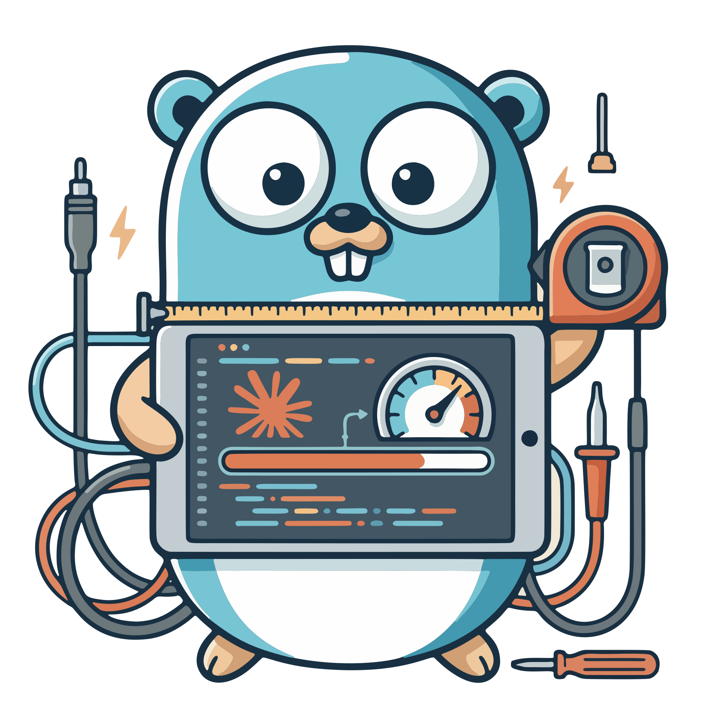
  <h1>ClaudeX</h1>

  <a href="https://github.com/tanq16/claudex/actions/workflows/release.yaml"></a>&nbsp;<a href="https://github.com/tanq16/claudex/releases"></a><br><br>
  <a href="#features">Features</a> &bull; <a href="#screenshots">Screenshots</a> &bull; <a href="#install">Install</a> &bull; <a href="#usage">Usage</a> &bull; <a href="#notes">Notes</a>
</div>

---

ClaudeX is an opinionated companion for Claude Code. It runs sessions across your Claude accounts from one local web UI, and keeps every instruction and skill inside the project.

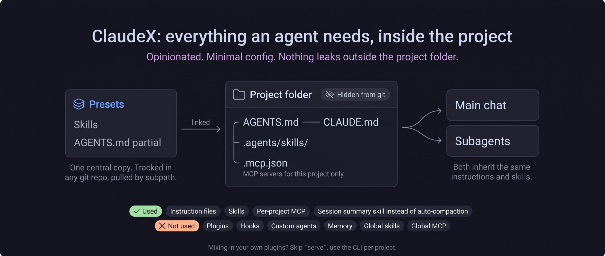

## Security

`serve` has no authentication. Anyone who reaches its port can run shell commands in your project directories and drive every session. It binds to `127.0.0.1` by default, so put an authenticating reverse proxy in front before exposing it.

## Features

Built to run Claude Code work from one page:

- Central skills and presets
- Project bootstrap, including `gh` clones
- MCP servers and settings across accounts
- Rendered chats beside the project's files
- Session tracking, restarts, and preset re-apply
- Conversations moved between accounts

And kept deliberately small:

- **Instructions and skills only.** `AGENTS.md` and skills drive every chat and subagent.
- **Presets.** Skills plus an `AGENTS.md` partial, kept once and linked into projects.
- **No extras.** No hooks, custom agents, memory, or global skills. The only plugin wires language servers.
- **Summaries over compaction.** The `session-summary` skill replaces auto-compaction.
- **Project-local.** Skills, instructions, and `.mcp.json` stay in the project, hidden from git.
- **Your own setup?** Skip `serve` and use the CLI per project.

## Screenshots

<details>
<summary>Click to expand</summary>

### Dashboard

| Desktop | Mobile |
| :---: | :---: |
| 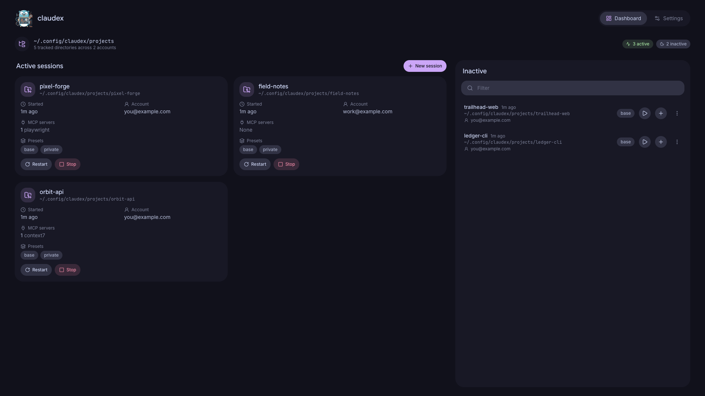 | 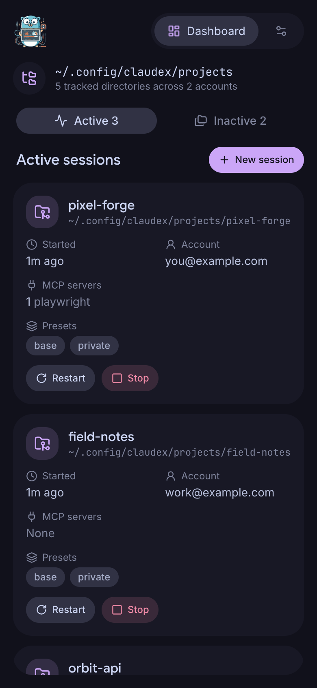 |

### New session

| Desktop | Mobile |
| :---: | :---: |
| 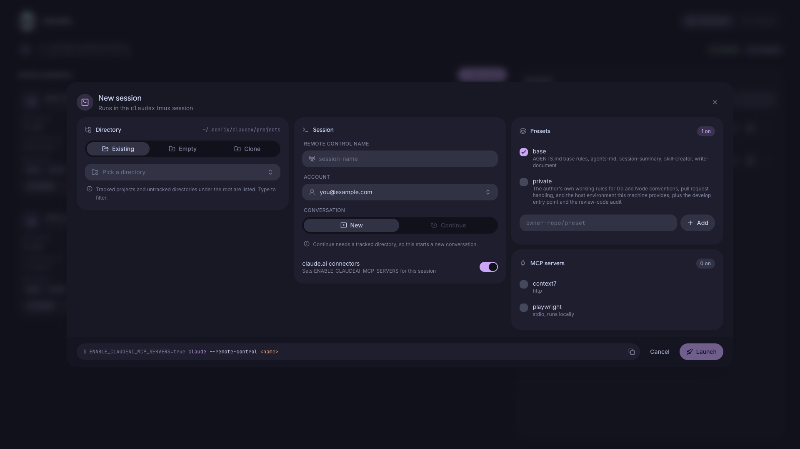 | 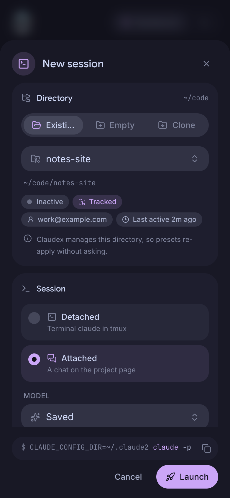 |

### Project

| Desktop | Mobile |
| :---: | :---: |
| 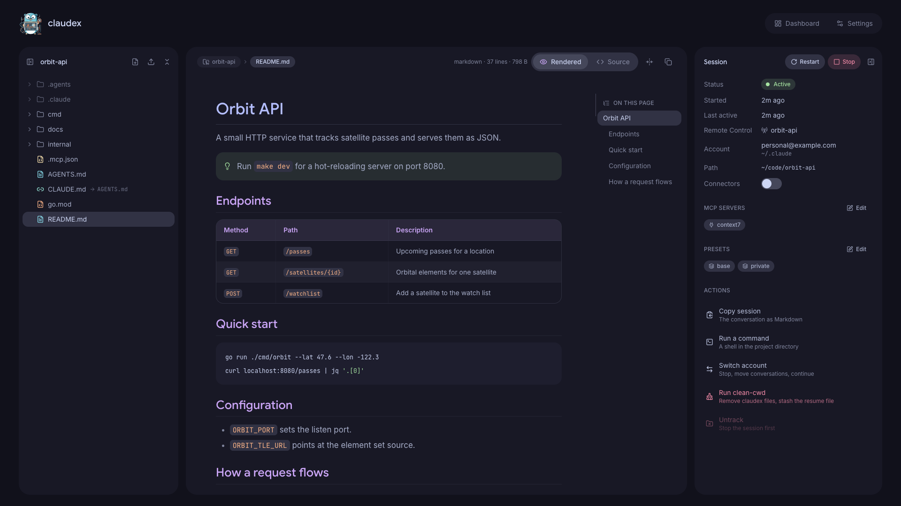 | 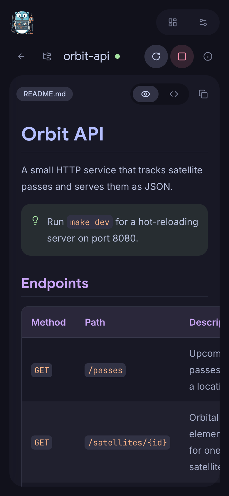 |

### Chat

| Desktop | Mobile |
| :---: | :---: |
| 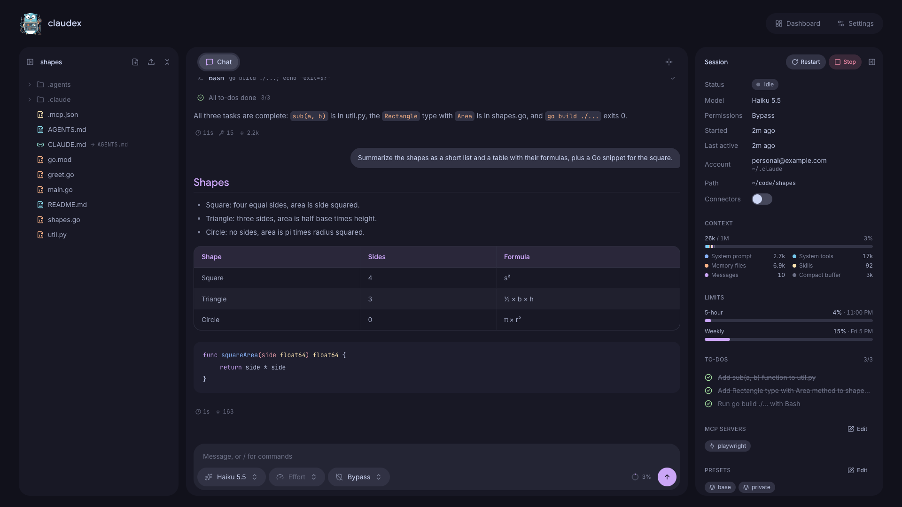 | 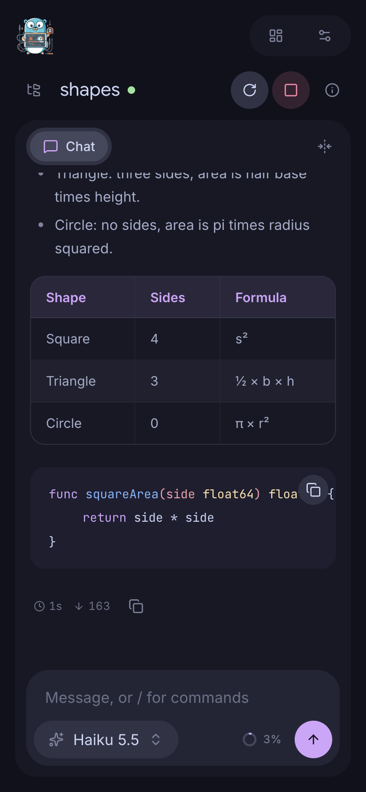 |

### Settings

| Desktop | Mobile |
| :---: | :---: |
| 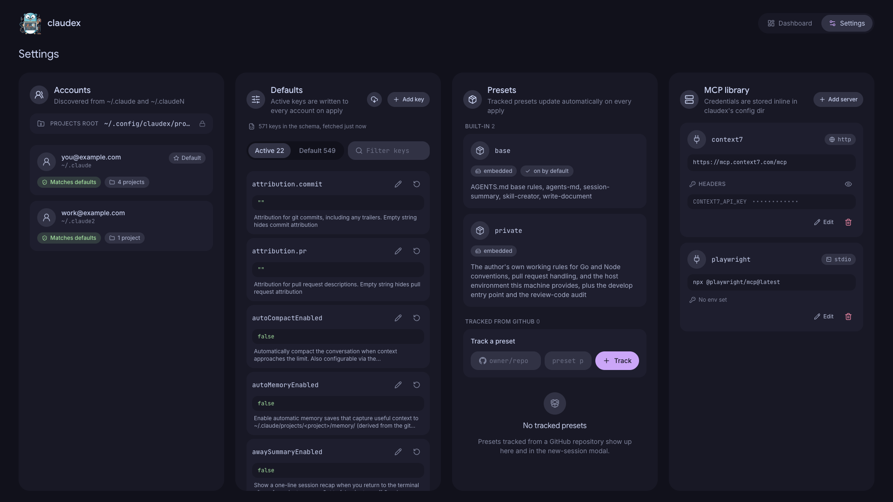 | 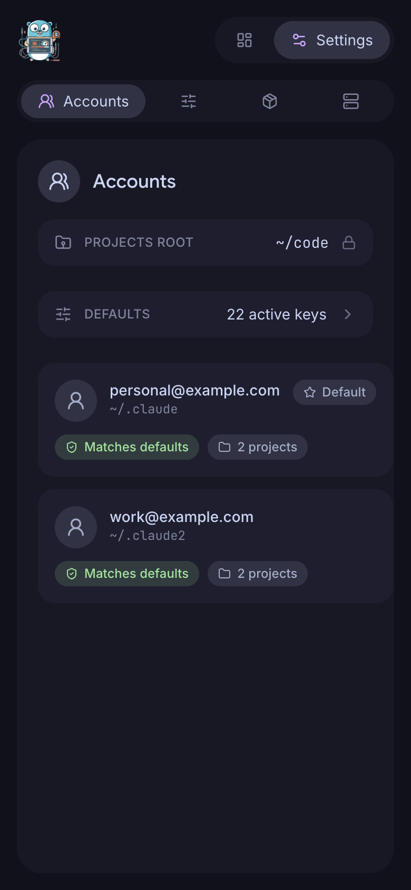 |

</details>

## Install

Prerequisites:

- `claude`, signed in, on your `PATH`.
- `tmux` for detached sessions.
- `gh`, signed in, to list and clone repositories from the web UI.
- `git` for pulling and tracking presets.
- Optional language servers, listed in [docs/language-servers.md](docs/language-servers.md).

### Release binary

```bash
# Linux/macOS
curl -sL https://github.com/tanq16/claudex/releases/latest/download/claudex-$(uname -s | tr '[:upper:]' '[:lower:]')-$(uname -m | sed 's/x86_64/amd64/;s/aarch64/arm64/') -o claudex
chmod +x claudex
sudo mv claudex /usr/local/bin/
```

Each release carries `claudex-linux-amd64`, `claudex-linux-arm64`, `claudex-darwin-amd64`, and `claudex-darwin-arm64`.

### From source

Needs Go 1.27.

```bash
git clone https://github.com/tanq16/claudex.git
cd claudex
make build
```

`make build-all` produces all four platform binaries instead.

## Usage

`serve` is the recommended way to run ClaudeX.

```bash
claudex configure            # once: set up every account
claudex serve --root ~/code  # http://127.0.0.1:8080
```

- **Detached sessions** run the `claude` terminal in tmux. `tmux attach -t claudex` reaches them.
- **Attached sessions** run as a chat on the project page, with approval cards.
- **New session** picks a directory, a mode, presets, MCP servers, and an account.
- **Settings** manages the account defaults, presets, and the MCP library.

The rest of `serve` is in [docs/serve.md](docs/serve.md).

### CLI

Every feature also works per project from the terminal. Each command is covered in [docs/cli.md](docs/cli.md).

| Category | Commands | Description |
|----------|----------|-------------|
| Accounts | `configure`, `switch` | Provision every account, move a project between accounts |
| Sessions | `launch`, `serve` | Exec `claude` under one account, or manage tmux and chat sessions from a web UI |
| Project layout | `apply`, `apply-preset`, `clean-cwd` | Write and remove the `AGENTS.md` and skills layout |
| Presets | `create-preset`, `pull-preset` | Scaffold your own bundle of skills and rules, or pull one from a repository |

## Notes

- **Accounts** are `~/.claude` and every `~/.claudeN`, such as `~/.claude2`.
- **Another repo's agent files** stay in your working tree when the repository tracks them. [docs/foreign-agent-files.md](docs/foreign-agent-files.md) covers the sparse-checkout that removes them.
